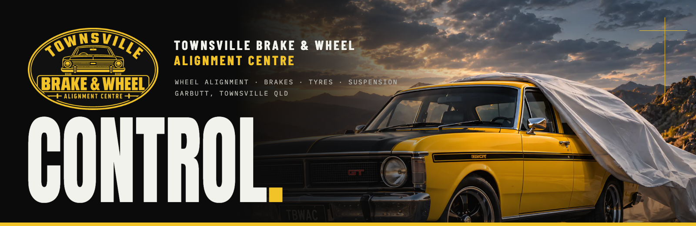
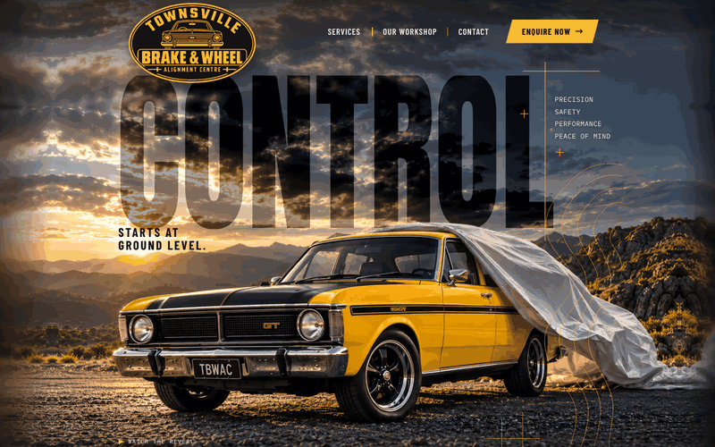
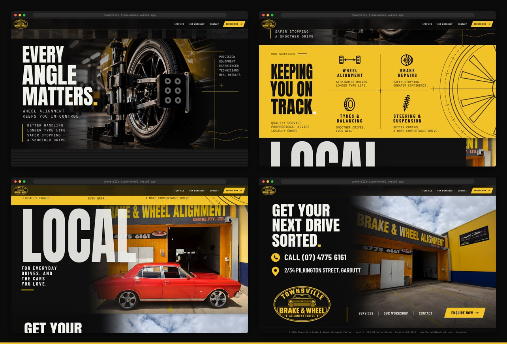
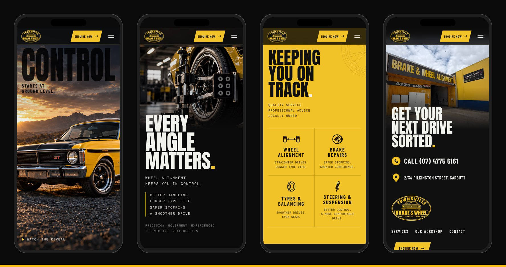
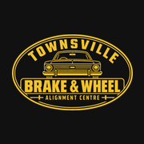

<div align="center">



<h3>A one-page website for a Townsville wheel alignment and brake workshop, built around a vintage Falcon GT revealed by the scroll.</h3>

<p>
  <a href="https://townsville-brake-wheel.vercel.app"><strong>🌐 Live site</strong></a>
  &nbsp;·&nbsp;
  <a href="#hero-animation"><strong>🎬 How the hero works</strong></a>
  &nbsp;·&nbsp;
  <a href="#getting-started"><strong>🛠️ Run it locally</strong></a>
</p>

<p>
  <a href="https://townsville-brake-wheel.vercel.app"></a>
  
  
  
  
</p>

</div>

<br />

## 🚀 Overview

**Townsville Brake & Wheel Alignment Centre** looks after brakes, tyres, steering, suspension and wheel alignment at 2/34 Pilkington Street, Garbutt. The site turns its promise into one idea: **control starts at ground level**. A yellow and black Falcon GT sits under a silver cover; as you scroll, the cover lifts and flies away, the camera settles on the front wheel, and that wheel opens onto an alignment clamp. From there the page walks visitors from the services to a call or an email in a few scrolls.

The desktop layout is the client's approved board, rebuilt to the pixel in its own units, and every section has its own move tied together by the wheel.

- **Cinematic first impression**: four photographic reveal states and three car cut-outs, not a video
- **Approved board, measured**: images registered to the board and every line of type fitted to its ink box
- **Clear path to contact**: call link, Google Maps address, and an enquiry form that writes the email for the visitor
- **Light**: 5.5 kB of JavaScript and 8.3 kB of CSS (gzip); phones load about 0.4 MB and never download the desktop reveal states

<br />

<a name="hero-animation"></a>

## 🎬 The hero animation

<div align="center">
  <a href="https://townsville-brake-wheel.vercel.app"></a>
  <sub>Scroll-scrubbed on the live site · captured at 1440 × 900</sub>
</div>

<br />

On load the cover slides back off the bonnet and **CONTROL** rises from behind the car. Then the poster scrolls down to the wheels and pins for 1.5 screen heights:

| Scroll        | What happens                                                                                     |
| :------------ | :----------------------------------------------------------------------------------------------- |
| Before the pin | The poster scrolls naturally to ground level; CONTROL lags behind the page for depth            |
| 0–30%         | The cover lifts from the rear of the car (bottom-up wipe with a soft light on the edge)          |
| 26–50%        | The cover flies off toward the mountains; the Falcon is fully revealed                           |
| 42–58%        | Tagline, notes and the film link step back                                                       |
| 54–100%       | An iris opens from the front tyre; inside it the alignment close-up grows from tyre size to 1:1  |
| 100%          | The close-up docks into **Every angle matters.** and its copy is typeset in                     |

**Under the hood**

- 🧭 **Board units.** Every length is a multiple of `--u = min(100cqw, 1920px) / 757`, the approved board's width, so the desktop page is the board at any screen size.
- 📐 **Registered, not guessed.** The four reveal states were aligned to each other and to the board with SIFT feature matching (scale and offset, `scripts/prepare-images.py`), upscaled with Real-ESRGAN, and the sky the board adds above the kit's frame was extended from the clothless state.
- ✂️ **CONTROL behind the car.** ISNet cut-outs of the car and cover sit above the headline and follow the same wipes as the states (`mask-composite: intersect`), so the letters are always behind whatever is on screen.
- 🔤 **Type fitted to the board.** `scripts/fit-type.py` turns measured ink boxes into CSS: size from cap height, tracking or horizontal scale from ink width, position from the fonts' own metrics.
- 🔁 **Seamless hand-off.** The pinned stage uses `top: min(0px, 100svh - stage height)`, the next section is pulled up under the iris and swaps in at progress 1; QA checks the swap pixel by pixel.
- 🐢 **Graceful by default.** Below 900 px, with `prefers-reduced-motion` or `?static`, there is no pin: the approved state is a still and the film opens on demand.

<br />

## 🖥️ Sections

<div align="center">
  
</div>

<br />

| #   | Section                                | Anchor       | Role and motion                                                                                         |
| :-- | :------------------------------------- | :----------- | :------------------------------------------------------------------------------------------------------ |
| 01  | **Control. Starts at ground level.**   | `#start`     | The reveal (above), header, first call to action                                                        |
| 02  | **Every angle matters.**               | `#alignment` | Why alignment matters; copy typesets in as the close-up docks, the photo drifts as it leaves             |
| 03  | **Keeping you on track.**              | `#services`  | The one solid colour: a roller door lifts on the yellow bay, the index draws itself, the wheel turns with the scroll; each service opens a detail sheet |
| 04  | **Local.**                             | `#local`     | The real red classic outside the workshop; the photo slides open, LOCAL rises letter by letter          |
| 05  | **Get your next drive sorted.**        | `#contact`   | Call, map and footer on the real workshop photo; the photo pans, the headline stamps in, the seal turns into place |

<br />

## 📱 Mobile first, motion optional

<div align="center">
  
</div>

<br />

- Portrait hero image with CONTROL set over the sky, no pinned scroll
- Photographic sections keep their photo as a top band; services become a 2 × 2 index on the yellow bay
- Touch targets of at least 44 px, no horizontal scroll at 360 and 390 px
- Phones download about 0.4 MB on first load; the desktop reveal states and cut-outs are never requested

<br />

## ✨ Highlights

- **🎞️ One rAF engine**: a single eased scroll loop drives every scroll-linked scene (`?nosmooth` for captures); entrances use the Web Animations API, created paused so a failed bundle never hides content
- **✉️ Enquiry without a backend**: validated form (name, vehicle, service, message) that opens the visitor's email app with the request written; it says plainly that no booking is confirmed
- **🎯 Service to enquiry**: *Enquire about this* inside a service sheet opens the form with that service selected
- **🎬 Film on demand**: the campaign reveal film loads only when the visitor presses *Watch the reveal*
- **♿ Accessible**: native `<dialog>` with focus return, skip link, labelled fields with an error summary, visible focus, real headings and alt text
- **🧪 Checked end to end**: `npm run qa` runs 50 checks in Chrome (pin sequence, hand-off, real clicks, deep links, phones, no-JS, reduced motion, copy hygiene) and `npm run compare` puts the page next to the board

<br />

## 💻 Tech stack

| <br />Vite 6 | <br />JavaScript | <br />HTML5 | <br />CSS3 | <br />Python | <br />OpenCV | <br />Vercel |
| :---: | :---: | :---: | :---: | :---: | :---: | :---: |

### Why this stack?

- **Vite + plain JavaScript**: a one-page site needs no framework runtime; the page is static HTML with four small modules
- **Own scroll engine + Web Animations API**: one rAF loop and native animations cover pinning, wipes and entrances without a library
- **Python image pipeline**: OpenCV registration, Real-ESRGAN upscaling and ISNet cut-outs run once at build time; the browser only gets AVIF/WebP
- **Self-hosted fonts** through Fontsource: no third-party requests
- **Vercel**: every push to `main` deploys automatically

<br />

## 🎨 Design system

| Token     | Value                                                                        | Use                                                  |
| :-------- | :--------------------------------------------------------------------------- | :--------------------------------------------------- |
| Yellow    |  | Services bay, buttons, rules, marks, focus           |
| Black     |  | Type on yellow, logo fill, compact bar               |
| Ink       |  | Page and section backgrounds                         |
| Off-white |  | Headlines and copy on photographs                    |

- **Type**: Anton for headlines (compressed per line to the board's ink), Barlow Condensed 600/700 for navigation and labels, IBM Plex Mono for technical notes
- **Grid**: the board itself, 757 units wide, capped at 1,920 px; phones use a 5 vw gutter
- **Logo**: the approved Logo A seal, with its oval filled black as on the board; proportions never altered
- **Motion**: one distinct move per section, 0.7–1.4 s entrances, nothing scaled beyond its photograph's own size

<br />

<a name="getting-started"></a>

## 🛠️ Getting started

```bash
# Clone the repository
git clone https://github.com/Jeanfr1/Townsville-Brake-Wheel-website.git
cd Townsville-Brake-Wheel-website

# Install dependencies (Node 20+)
npm install

# Start the dev server  →  http://localhost:5173
npm run dev

# Production build  →  dist/
npm run build

# Preview the production build  →  http://localhost:4319
npm run preview

# End-to-end checks and the page-vs-board comparison (need the preview and Google Chrome)
npm run qa
npm run compare

# Rebuild the images: masters from the kit (Python with torch + opencv), then AVIF/WebP
npm run prepare-images
npm run images

# Verify the design kit's integrity
npm run check:kit
```

<br />

## 📁 Project structure

```
Townsville-Brake-Wheel-website/
├── index.html                  # Every section: hero → alignment → services → local → contact + footer
├── src/
│   ├── main.js                 # Entry: fonts, styles, module init
│   ├── data/site.js            # Business facts, written into the HTML at build time
│   ├── styles/
│   │   ├── base.css            # Tokens, buttons, compact bar, dialogs
│   │   ├── board.css           # Desktop = the approved board in board units
│   │   ├── board-fit.css       # Generated by scripts/fit-type.py
│   │   ├── phone.css           # Stacked layout below 900 px
│   │   └── motion.css          # Reveal wipes, hand-off, roller door
│   └── js/
│       ├── engine.js           # One eased rAF loop for scroll-linked scenes
│       ├── hero.js             # Intro, reveal states, iris hand-off
│       ├── scenes.js           # One move per section
│       └── ui.js               # Dialogs, enquiry email, menu, compact bar
├── public/                     # img/ (AVIF + WebP), media/ (film), icons, robots.txt
├── scripts/                    # register-board, measure-*, fit-type, prepare-images, upscale,
│                               # make-mattes, build-images, qa, compare-board, readme assets
├── docs/ · roteiros/ · images-master/ · originals/ · references/ · animation/ · site/
│                               # the client's design kit, kept as delivered (not deployed)
└── LEIA-ME-KIT.md              # the kit's own read-me
```

<br />

## 🚀 Deployment

Hosted on **Vercel** and connected to this repository: every push to `main` ships to production.

**Live site:** [townsville-brake-wheel.vercel.app](https://townsville-brake-wheel.vercel.app)

| Setting          | Value           |
| :--------------- | :-------------- |
| Framework        | Vite            |
| Build command    | `npm run build` |
| Output directory | `dist`          |

The site is `noindex` (meta tag, `X-Robots-Tag` header and `robots.txt`) until it moves to its final domain. `/img` and `/media` are served with an immutable cache, so a changed image always gets a new file name.

<br />

## 📌 Content checklist

Items waiting on the client. Each one is marked `TODO(tbwac)` in the code.

- [ ] Final domain (then add `canonical` and `og:url`, and remove `noindex`)
- [ ] The business's own Google Maps place link (the address currently opens a search)
- [ ] Sign-off on the board wording kept on the page: *Precision equipment · Experienced technicians · Real results* and *Quality service · Professional advice · Locally owned* (Localsearch lists the business as locally owned with over 20 years of experience)
- [ ] Permission for the two Facebook photos used (the red classic and the workshop front)
- [ ] Opening hours and ABN, only once confirmed (not shown)

Choices made where the kit contradicted itself:

- The kit's script asks for the reveal film to play inside the hero with a scrubber; the hero is scroll-driven from the same four states instead, and the film opens in a viewer.
- The board re-renders the workshop and the red classic; the kit forbids reconstructed façades, so the real photos are used in the board's composition.
- The board's alignment close-up shows a black car; the kit's close-up of the same yellow Falcon is used, so the hero hands off to the same car.
- Image credits and process notes stay in this README and the kit, not on the page.

<br />

## 🙏 Acknowledgments

- **Townsville Brake & Wheel Alignment Centre** for the brief and the approved direction
- **[Real-ESRGAN](https://github.com/xinntao/Real-ESRGAN)** by Xintao Wang et al. (BSD-3-Clause) for upscaling
- **[DIS / ISNet](https://github.com/xuebinqin/DIS)** by Xuebin Qin et al. (Apache-2.0) for the car cut-outs
- **[Anton](https://fonts.google.com/specimen/Anton)**, **[Barlow Condensed](https://fonts.google.com/specimen/Barlow+Condensed)** and **[IBM Plex Mono](https://fonts.google.com/specimen/IBM+Plex+Mono)** (OFL), self-hosted with **[Fontsource](https://fontsource.org)**
- **[Vite](https://vite.dev)** and **[Vercel](https://vercel.com)**

<br />

---

<div align="center">
  
  <p><strong>Control starts at ground level.</strong></p>
  <p>Built with ❤️ by <a href="https://github.com/Jeanfr1">Jean</a> for Townsville Brake &amp; Wheel Alignment Centre</p>
  <sub>© 2026 Townsville Brake &amp; Wheel Alignment Centre. All rights reserved.</sub>
</div>
